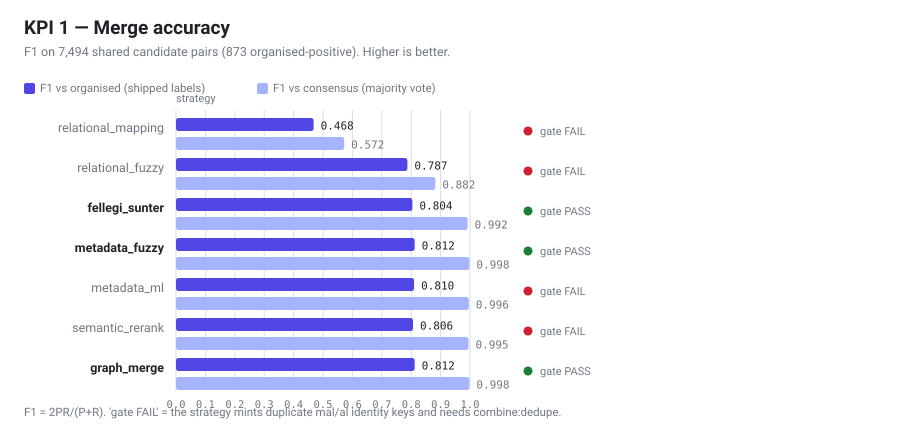
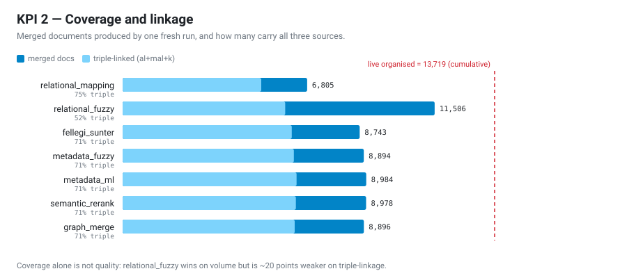
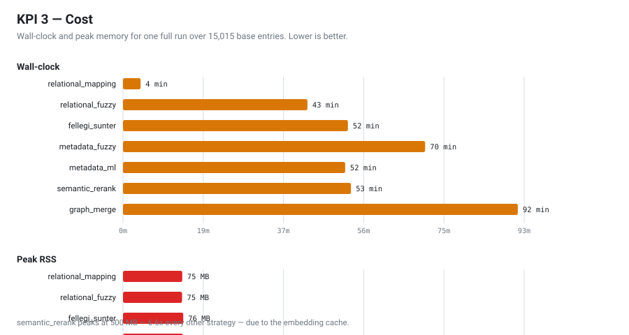
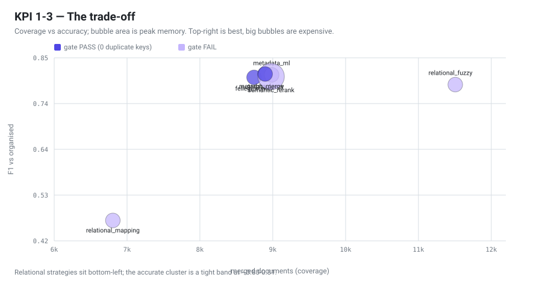

# Hiyori CLI

[](https://www.php.net/) [](http://discord.jikan.moe)

[](https://github.com/Hiyori-API/hiyori-cli/actions/workflows/ci.yml) []() []() []()

Hiyori CLI builds and maintains [HiyoriDB](https://github.com/Hiyori-API/HiyoriDB) — a relational anime & manga database. It ingests from **AniList, Kitsu and MyAnimeList** (anime and manga), merges everything into a normalized schema, and ships a live React dashboard for exploring, managing and analyzing the result.

> [!NOTE]
> Under active development. The CLI pipeline and dashboard are feature-complete for the current roadmap; expect continued hardening. See [docs/](docs/dashboard-roadmap.md) for the tracked status.

---

## Features

- **Multi-source ingestion** — MyAnimeList (Official API v2), AniList and Kitsu, for both **anime** and **manga** collections, with per-source rate limiting, circuit breakers and resume support.
- **Schema normalization** — source-specific values (statuses, types, seasons) are mapped onto the shared [Hiyori Schema](#hiyori-schema) via enums.
- **Relational mapping** — known source cross-references are parsed into `reference_ids` (`mal`, `al`, `k`, …); supported references are resolved to per-source IDs.
- **Combiner with 7 strategies** — `relational_mapping`, `relational_fuzzy`, **`metadata_fuzzy`** (default, weightage-tuned), `graph_merge`, `fellegi_sunter`, `semantic_rerank` (local embeddings) and `metadata_ml` (trained logistic second-stage scorer).
- **Live dashboard** — a React + shadcn/ui SPA (PHP `php -S` backend) with **Dashboard, Explorer and Settings** pages, realtime SSE, PWA caching and an **Environment manager**. The Dashboard carries the source fleet, backups, the merge-quality chart and the scheduler; Settings carries the rate limiter.
- **Backups & restore** — `mongodump`/`mongorestore` based, scriptable and dashboard-triggered.
- **Scheduler** — run ingestion on a schedule via systemd timers/cron (`schedule --install`).
- **Utilities** — validation against the schema, sweeping (orphans/duplicates/incomplete), weightage analysis, export (JSON/JSONL/CSV), Prometheus metrics and health checks.
- **Docker** — `docker-compose.yml` for MongoDB + the CLI.

---

## Quick start

```bash
# 1. Install dependencies
composer install

# 2. Configure the environment
cp .env.example .env
#    → set MONGODB_URL and (for MAL ingestion) MAL_CLIENT_ID / MAL_CLIENT_SECRET

# 3. Ingest a source (anime by default)
php hiyori ingest anilist

# 4. Combine ingested data into the `organized` collection
#    --passthrough keeps base entries that matched nothing as their own records,
#    so every ingested entry has a document and its hiyori_id stays attached to one
php hiyori combine anilist --passthrough

# 5. Open the live dashboard
php hiyori dashboard:serve                 # http://127.0.0.1:8080
php hiyori dashboard:serve --install       # or install a systemd user unit
```

See [Installation](#installation) for prerequisites and the [Commands](#commands) section for every available command.

---

## Installation

Prerequisites:

- **PHP 8.3+** (the version exercised in CI) with the `mongodb`, `mbstring`, `xml`, `curl` and `zip` extensions
- **MongoDB** (7.x) running locally or remotely
- **Composer**

```bash
git clone https://github.com/Hiyori-API/hiyori-cli.git
cd hiyori-cli
composer install
chmod +x hiyori          # optional — `php hiyori` works everywhere
cp .env.example .env     # then edit to taste
```

---

## Commands

The tool runs as `./hiyori`, `php hiyori` or `php src/run.php`.

| Command | Description |
|---|---|
| `ingest <source>` | Begin ingestion from a source (`myanimelist`, `anilist`, `kitsu`) |
| `ingest:all` | Run ingestion for all available sources sequentially |
| `combine <base>` | Merge all source datasets into one collection (`--passthrough` keeps entries that matched nothing; `--rejection-buffer` writes borderline title-floor rejections to `pair_rejections`) |
| `validate` | Validate existing data against the Hiyori schema |
| `sweep` | Clean up orphaned, duplicate or incomplete entries |
| `weightage <s1> <s2>` | Calculate ideal metadata-fuzzy weights between two sources |
| `ml:export-pairs` | Export labelled candidate pairs (JSONL) for ML training / benchmarking |
| `ml:train` | Train the `metadata_ml` logistic-regression scorer from exported pairs |
| `ml:llm-judge` | Adjudicate pending rejection-buffer pairs with an LLM for the ambiguous 70-85 band (`LLM_API_KEY`-gated; cached in `llm_judgements`) |
| `labels` | Add / inspect human pair labels (agree/disagree) that override the organized ground truth |
| `rejections` | Work the rejection buffer — review turned-down pairs (approve/reject/unsure) and promote decided ones into training labels |
| `combine:benchmark` / `bench` | Offline precision/recall/F1 sweep of `metadata_fuzzy` vs `metadata_ml` from labelled pairs |
| `combine:dupes` / `dupes` | Detect duplicate reference keys in combined collections (release gate: `mal`/`al` must stay unique) |
| `combine:dedupe` / `dedupe` | Resolve duplicate identity keys in place (release-gate unblocker; keeps the key on its base-corroborated owner, never deletes documents) |
| `combine:consensus` / `consensus` | Rank every strategy against one shared pair sample: F1 vs consensus, vs `organized`, and vs human labels |
| `combine:fs-calibrate` | Fit Fellegi-Sunter `m`/`u` probabilities from labelled pairs; the strategy reads the saved file via `--config '{"mu_file":"..."}'` |
| `references` | Return all unique reference IDs from the combined DB |
| `export` | Export data from sources or combined DB (profiles: per-entry-json, bulk-jsonl, tables-csv) |
| `backup` | Back up the database with `mongodump` |
| `restore <archive>` | Restore the database from an archive with `mongorestore` |
| `schedule` | Run ingestion on a schedule (systemd timers / cron) |
| `health` | Health check for services and dependencies |
| `metrics` | Expose Prometheus metrics |
| `dashboard:serve` | Serve the live dashboard (UI + API + SSE + `/metrics`) |
| `publish` / `db:push` | Build relational dump and push to HiyoriDB repository (`--verify`, `--max-changed`) |
| `release` / `db:release` | Build, verify and publish a compressed Tier B release (`.tar.zst` + sidecars + `SHA256SUMS.txt`) |
| `completion` | Dump a shell completion script |
| `hiyori-id` / `ids` | Report / backfill / verify Hiyori IDs (`--verify`, `--backfill`, `--json`) |

### Ingestion

```console
php hiyori ingest myanimelist --delay 1   # anime
php hiyori ingest anilist --delay 1
php hiyori ingest kitsu --delay 1

php hiyori ingest myanimelist_manga --delay 1   # manga
php hiyori ingest anilist_manga --delay 1
php hiyori ingest kitsu_manga --delay 1

php hiyori ingest:all                     # all sources, sequentially
```

| Option | Description |
|--------|-------------|
| `--delay`, `-d` | Delay between requests in seconds (default: `1`); keep ≥1s to respect source rate limits |
| `--update`, `-u` | Update existing entries instead of skipping |
| `--resume-page`, `-r` | Resume from a specific page number |

> [!NOTE]
> 1. Spoiler-tagged metadata (general or media) is not ingested.
> 2. AniList caps reported totals at 5,000 per query. Ingestion works around the cap by chunking the catalog by `seasonYear` (1950 → current year + one no-year pass); manga continues past the cap via pagination on short/empty pages.

### Combining

Run the combiner **after** ingestion of the sources you want merged has completed.

```console
php hiyori combine {base} [--strategy {strategy}]
```

`{base}` is the source dataset to merge from (e.g. `myanimelist`, `anilist`, `kitsu_manga`). Sources are merged **into** the `organized` collection by default.

| Option | Description |
|--------|-------------|
| `--strategy`, `-s` | One of the seven strategies below. **Default: `metadata_fuzzy`** |
| `--threshold`, `-t` | `metadata_fuzzy` score threshold, 0–100 (default: `70`) |
| `--weights`, `-w` | `metadata_fuzzy` field weights as JSON, e.g. `{"title":25,"tags":20}` |
| `--config` | Extra strategy config as JSON, e.g. `{"ml_threshold":0.6}`. Checked against the keys the selected strategy reads — an unknown key is refused (see [Strategy config keys](#strategy-config-keys)) |
| `--into` | Collection to merge into (e.g. `organized_manga`). Default: `organized` |
| `--passthrough` / `--no-passthrough` | Keep a base entry that matched nothing as its own single-source record. **Off by default** (see below) |
| `--export` | After combine, run exporter with profile (`per-entry-json`, `bulk-jsonl`, `tables-csv`, or `none`). Default: `combiner.auto_export` config value |
| `--skip-migrations` | Bypass the pending-migration gate (not recommended) |

#### Passthrough records

The merge loop only writes a document when at least one candidate matched, so a
base entry that matches nothing used to disappear from the merged collection
entirely. That is fine for a benchmark (documents produced ≈ merging ability) and
wrong for a release build:

- the `hiyori_id` the registry allocated for that entry on an earlier run is left
  with **no document**, and `php hiyori hiyori-id --verify` reports it;
- the merged collection ends up holding *fewer* records than the base dataset has
  entries, with no record of which ones went missing.

`--passthrough` writes those entries as their own records instead, keyed by their
own reference, so a rebuild reuses the ids it already has and only allocates ids
for entries it has genuinely never seen.

```console
# Release build: one document per base entry, id-stable
php hiyori combine anilist --passthrough

# Benchmark run: measure merging alone (no single-source records)
php hiyori combine anilist --strategy metadata_fuzzy --into bench_metadata_fuzzy
```

A passthrough record carries **no `confidence`** — it is not a merge, and a `0.0`
would park it in the bottom histogram bin and feed it to the spot-check sampler
as though a merge had been scored and failed. That absent field is what marks a
record as single-source: `reference_ids` is the base entry's own reference set,
which is one key for a minority of records and several for the rest, because
sources ship cross-references on the entries themselves (AniList carries
`mal`/`yt`/`tx`/`nf`/`ttv`/`cr`/`ap`).

`combine` warns before the run when the target is `organized`/`organized_manga`
and `--passthrough` is off, because that combination silently drops coverage.

#### Available strategies

- **`relational_mapping`** — merges entries whose source IDs match directly across the available datasets.
- **`relational_fuzzy`** — cross-checks every `reference_ids` value across datasets to find the same entry in another source.
- **`metadata_fuzzy`** *(default)* — compares entry metadata, weighting each field (Levenshtein for titles, Jaccard for tags). Entries are merged when the weighted score exceeds the threshold. The built-in weights were tuned via `hiyori weightage` on ground-truth MAL↔AniList pairs:

- **`graph_merge`** — transitive connected-component merge over low-confidence candidates (catches A↔B↔C pairs that `metadata_fuzzy` misses).
- **`fellegi_sunter`** — probabilistic record linkage with configurable `m`/`u` field probabilities.
- **`semantic_rerank`** — `metadata_fuzzy` candidates re-ranked with local embeddings (`ML_EMBED_COMMAND` sidecar; deterministic n-gram fallback). Vectors are cached in the `embeddings` Mongo collection (read/write-through, keyed by `(content_hash, model, model_version)`); the JSON file cache is the fallback when no database is injected.
- **`metadata_ml`** — `metadata_fuzzy` candidate chain + anchor rejection, scored by a logistic-regression model trained on labelled pairs (`ml:export-pairs` → `ml:train`). Merges carry `ml_score`/`ml_model`/`ml_model_version`/`ml_decision`/`ml_decided_at`. Requires a trained model (hard error otherwise).
  | field | weight | | field | weight |
  |---|---|---|---|---|
  | `title` | 26.4 | | `status` | 0.6 |
  | `episodes` | 26.2 | | `season` | 16.4 |
  | `year` | 23.2 | | `type` | 5.7 |
  | `tags` | 1.5 | | `synonyms` | 0 |

  Weights are normalized at runtime, so they need not sum to 100.

#### Strategy config keys

Every strategy declares the config keys it reads (`src/Service/StrategyConfigKeys.php`), and
`--config` is checked against the selected strategy **before** the run starts:

```console
$ php hiyori combine myanimelist --config '{"thresold":80}'
Unknown config key "thresold" (value: int(80)) for strategy "metadata_fuzzy". Accepted keys:
anchor_episodes, anchor_rejection, anchor_year_tolerance, collection, passthrough, rejection_buffer,
rejection_buffer_collection, rejection_buffer_floor, resume, same_kind_candidates, sweep, threshold,
title_floor, weights
```

A key that belongs to another strategy (`{"ml_threshold":0.6}` on `metadata_fuzzy`) is refused the
same way. Keys several strategies share — `collection`, `threshold`, `weights`, `passthrough`,
`title_floor`, `same_kind_candidates`, the `anchor_*` keys, `resume` — are accepted everywhere.

The same rule applies to the rest of the configuration: a missing or mistyped key in
`src/Config/Sources.php` stops the command with the file, the source and the key in the message,
and a malformed `hiyori.export.json` (or `storage/state/export.json`) is an error instead of a
silently default export. A *missing* file is not an error — there is a difference between "no
state" and "broken state".

Example — build the manga collection separately from the anime merge:

```console
php hiyori combine anilist_manga --strategy metadata_fuzzy --into organized_manga
```

#### Which strategy should I pick?

All seven strategies were benchmarked side by side on **2026-10-16**: same base
(`anilist`, 15,015 entries), same revision, each merged into its own scratch collection so
the live `organized` was never touched. Method, caveats, raw artifacts and the full
write-up live in [`docs/combiner-strategy-benchmark.md`](docs/combiner-strategy-benchmark.md).

Three KPIs matter and they disagree with each other, so pick by what you are optimising for.

**KPI 1 · Accuracy.** F1 over 7,494 shared candidate pairs (873 `organized`-positive),
scored both against the shipped `organized` labels and against a consensus majority vote of
all seven strategies:



**KPI 2 · Coverage & linkage.** Documents produced by one fresh run, and how many of them
carry all three identity sources (`al` + `mal` + `k`):



**KPI 3 · Cost.** Wall-clock and peak memory. The benchmark host was shared, so compare the
strategies against each other rather than quoting absolute minutes:



**All three at once** — coverage vs accuracy; bubble area is peak memory:



##### The numbers

| strategy | docs | wall | peak RSS | triple-linked | avg refs | dup `mal` | new ids | F1 (organised) | F1 (consensus) | gate |
|----------|-----:|-----:|---------:|--------------:|---------:|----------:|--------:|---------------:|---------------:|:----:|
| `relational_mapping` | 6,805 | 4m06s | 75 MB | 75.1 % | 3.34 | 2 | 386 | 0.468 | 0.572 | ✗ |
| `relational_fuzzy` | 11,506 | 42m54s | 75 MB | 52.1 % | 3.31 | 6 | 684 | 0.787 | 0.882 | ✗ |
| `fellegi_sunter` | 8,743 | 52m19s | 76 MB | 71.3 % | 3.54 | 0 | 4 | 0.804 | 0.992 | ✓ |
| `metadata_fuzzy` | 8,894 | 70m17s | 76 MB | 71.0 % | 3.53 | 0 | 4 | **0.812** | 0.998 | ✓ |
| `metadata_ml` | 8,984 | 51m42s | 76 MB | 71.4 % | 3.53 | 3 | 117 | 0.810 | 0.996 | ✗ |
| `semantic_rerank` | 8,978 | 53m03s | **500 MB** | 71.2 % | 3.53 | 2 | 84 | 0.806 | 0.995 | ✗ |
| `graph_merge` | 8,896 | **91m51s** | 76 MB | 71.3 % | 3.54 | 0 | 5 | **0.812** | 0.998 | ✓ |
| *live `organized` (cumulative)* | *13,719* | — | — | *80.4 %* | *3.72* | *0* | — | — | — | ✓ |

**`gate`** is the release gate (`combine:dupes`): a strategy that mints duplicate `mal`/`al`
identity keys needs `combine:dedupe` before it can ship. **`F1 (organised)`** is the honest
one — it scores against labels the strategies did not produce; **`F1 (consensus)`** is a
majority vote of the strategies themselves, so it compresses the top five.

> **Coverage caveat.** A *single* fresh run tops out at 11,506 documents, while live
> `organized` holds 13,719 — because `organized` accumulates across bases and runs. Use the
> doc counts to compare strategies with each other, not against `organized`.

##### So which one?

| if you optimise for… | use | why |
|---|---|---|
| **default, best accuracy** | `metadata_fuzzy` | Highest gate-passing F1 (0.812), byte-identical on a re-run, lowest registry churn (4 new ids), and it is what the live collection was built with. |
| **speed / CI** | `fellegi_sunter` | Fastest of the accurate cluster (52m vs 70m) and gate-clean, for 0.008 F1. |
| **the ML track** | `metadata_ml` | Within 0.002 F1 of the default, ~27 % faster, and properly calibrated (scores 0.51–1.00). Blocked by 3 duplicate keys *and* by the F1 gate: the 2026-10-16 holdout re-run put it **+1.2 pts** over the default (0.988 vs 0.976 best-vs-best), short of the required 2. |
| **reach over precision** | `relational_fuzzy` | +29 % documents over the default — but they are `anilist`-only, it fails the gate and it is the slowest per document. |
| **nothing — experiments only** | `graph_merge`, `semantic_rerank`, `relational_mapping` | See below. |

##### Recommended set

**Keep three — `metadata_fuzzy`, `fellegi_sunter`, `metadata_ml`.**

* **`metadata_fuzzy`** — the default stays. Nothing measured beats it on gate-passing
  accuracy, it is byte-for-byte deterministic, and it mints almost no new ids. It is also
  the slowest of the accurate cluster, which is exactly why it needs a cheaper sibling.
* **`fellegi_sunter`** — the fast accurate path. 52m vs 70m for `metadata_fuzzy`, 0.008 F1
  behind it, gate-clean. This is the one to reach for in CI or on a laptop.
* **`metadata_ml`** — the successor. Matches the default on accuracy, ~27 % faster,
  calibrated, and the only strategy with a training loop. Its 3 duplicate keys are a
  `combine:dedupe`-shaped bug rather than a modelling problem, so it is the one worth
  investing in — but it is not a swap away from shipping: on the 2026-10-16 held-out
  split it beat the default by **1.2 F1 points** (0.9880 vs 0.9760, best-vs-best)
  where the gate wants 2, so the default has not moved
  (`docs/dashboard-roadmap.md` → release gate).

**Drop four — `relational_mapping`, `relational_fuzzy`, `semantic_rerank`, `graph_merge`.**

* **`relational_mapping`** — recall 0.412. It found fewer than half the true merges; it is an
  ID-join, not a combiner. Remove it.
* **`relational_fuzzy`** — coverage without linkage. Its 2,612 extra documents over
  `metadata_fuzzy` are ~20 points weaker on triple-linkage; it fails the gate with 6
  duplicate keys, mints 684 new ids (~170× the default), and is the slowest per document.
  Its "reach" is the weakest kind of merge.
* **`semantic_rerank`** — 6.6× the memory (500 MB) for F1 between `fellegi_sunter` and
  `metadata_ml`, and it fails the gate. The local n-gram fallback does not pay for itself;
  revisit only if a hosted embedding backend is added.
* **`graph_merge`** — the *closest* call. It ties `metadata_fuzzy` on accuracy and passes the
  gate, but costs +31 % wall-clock (91m51s — the slowest run) for no measurable gain. Keep it
  only if transitive A↔B↔C clustering is an explicit product requirement; otherwise it is
  strictly dominated.

Net: three strategies cover every measured requirement — accuracy (`metadata_fuzzy`), speed
(`fellegi_sunter`) and the ML track (`metadata_ml`).

### Utilities

```console
# Validate existing data against the Hiyori schema
php hiyori validate [--source anilist|organized] [--limit N] [--json]

# Clean up orphaned / duplicate / incomplete entries
php hiyori sweep [--source myanimelist] [--dry-run] [--orphans|--duplicates|--incomplete|--all]

# Report all unique reference IDs from the combined DB
php hiyori references [--source mal] [--json]

# Tune metadata-fuzzy weights between two sources (feeds combine --weights)
php hiyori weightage myanimelist anilist [--sample 1000] [--json]

# Capture a human label for a candidate pair (overrides the organized ground truth).
# The dashboard's merge sampler posts these to POST /api/labels on agree/disagree.
php hiyori labels add --base-source mal --base-id 1 --candidate-source al --candidate-id 2 --label 1
php hiyori labels stats
php hiyori labels list --base-source mal --base-id 1

# Work the rejection buffer: review turned-down pairs, then promote the decided
# ones into training labels (approve -> agree, reject -> disagree; unsure skipped).
php hiyori rejections add --base-source mal --base-id 1 --candidate-source al --candidate-id 2 --decision reject
php hiyori rejections list
php hiyori rejections stats
php hiyori rejections promote

# Export labelled candidate pairs for ML (human labels win over the organized collection).
# --holdout writes a deterministic, group-safe -train/-holdout pair of files:
php hiyori ml:export-pairs --base myanimelist [--limit 500] [--negatives 3] [--sample random|first] [--holdout 30]

# Adjudicate pending rejection-buffer pairs with the LLM (env-gated; no-op without LLM_API_KEY).
# Only the ambiguous band is sent; results are cached in llm_judgements so re-runs are free.
php hiyori ml:llm-judge [--limit N] [--dry-run] [--json]

# Train the metadata_ml scorer from the newest exported pairs file
php hiyori ml:train [--in storage/ml/pairs-*.jsonl] [--epochs 400] [--threshold 0.5]

# Combine with the ML scorer (needs the model file; tune via --config JSON)
php hiyori combine myanimelist --strategy metadata_ml --config '{"ml_threshold":0.6,"metadata_floor":55}'

# Benchmark scorers offline (no DB writes): F1 gate at 60/65/70/75/80/85/90.
# Honest gate: train on the -train file, benchmark on the untouched -holdout file.
php hiyori ml:train --in storage/ml/pairs-*-train.jsonl
# --margin sets the required F1 advantage (points) of metadata_ml over metadata_fuzzy;
# --strict exits non-zero when the gate is not met (for CI).
php hiyori combine:benchmark --in storage/ml/pairs-*-holdout.jsonl [--ml-model storage/state/ml-model.json] [--margin 2] [--strict] [--json]

# Release gate: no combined collection may repeat an identity key (mal/al).
# Reports every duplicated source key; franchise keys (k/cr/t/nf) are expected
# to repeat.
php hiyori combine:dupes [--collection organized] [--primary mal,al] [--json]

# Unblock the gate when a source itself repeats an identity key (for example the
# same `mal` value ingested on two AniList rows). The key is removed from the
# losing document — the genuine owner is the one whose base row declares it —
# so nothing is deleted and ids/coverage stay stable. Idempotent, --dry-run safe.
php hiyori combine:dedupe [--collection organized] [--primary mal,al] [--dry-run] [--no-corroborate] [--json]

# Export data (organized by default) as JSON, JSONL or CSV
# Export combined DB with the configured profile (default per-entry-json)
php hiyori export [--profile per-entry-json|bulk-jsonl|tables-csv] [--dry-run] [--preview manga]

# Export a raw source as JSON/JSONL/CSV (legacy format)
php hiyori export organized|myanimelist|anilist|kitsu [--format json|jsonl|csv] [--output file] [--fields title,type,status] [--limit 100] [--pretty]

# Back up / restore the database (mongodump / mongorestore)
php hiyori backup [--output storage/backups/hiyori-<ts>.gz] [--collections a,b,c] [--gzip]
php hiyori restore storage/backups/hiyori-<ts>.gz [--drop]

# Health check for MongoDB, external APIs, rate limiter, disk and memory
php hiyori health [--json] [--watch] [--interval 30]

# Render Prometheus metrics as text (one-shot, to stdout; the dashboard's
# /metrics endpoint serves them over HTTP for scraping)
php hiyori metrics
```

---

## Hiyori Schema

All sources are transformed into a common representation. Values with different spellings across sources (e.g. MAL `Finished Airing` vs AniList `Finished`) are normalized through Hiyori's enums.

### Anime

| Property        | Data Type          | Remarks                                                            | Nullable |
|-----------------|--------------------|--------------------------------------------------------------------|----------|
| `title`         | _String_           | Entry's main title                                                 | ❌        |
| `synonyms`      | _Array of String_  | All other titles (combined from sources)                           | ❌        |
| `type`          | _String_           | Entry type [`tv`, `movie`, `ova`, `ona`, `special`, `music`]       | ✅        |
| `episodes`      | _Integer_          | Number of episodes (if any mentioned)                              | ✅        |
| `status`        | _String_           | Status of entry [`finished`, `airing`, `to_be_aired`, `cancelled`] | ✅        |
| `season`        | _Nullable String_  | Release Season [`winter`, `summer`, `spring`, `fall`]              | ✅        |
| `year`          | _Nullable Integer_ | Release Year                                                       | ✅        |
| `images`        | _Array of String_  | Default Image URLs (combined from sources)                         | ❌        |
| `reference_ids` | _Object_           | Parsed IDs from Supported References                               | ❌        |
| `references`    | _Array of String_  | Reference URLs (combined from sources)                             | ❌        |
| `tags`          | _Array of String_  | Genres/Tags (combined from sources)                                | ❌        |

### Manga

| Property        | Data Type          | Remarks                                                            | Nullable |
|-----------------|--------------------|--------------------------------------------------------------------|----------|
| `title`         | _String_           | Entry's main title                                                 | ❌        |
| `synonyms`      | _Array of String_  | All other titles (combined from sources)                           | ❌        |
| `type`          | _String_           | Entry type [`manga`, `novel`, `light_novel`, `one_shot`, `doujinshi`, `manhwa`, `manhua`, `oel`] | ✅ |
| `chapters`      | _Integer_          | Number of chapters (if any mentioned)                              | ✅        |
| `volumes`       | _Integer_          | Number of volumes (if any mentioned)                               | ✅        |
| `status`        | _String_           | Status of entry [`finished`, `publishing`, `not_yet_published`, `on_hiatus`, `discontinued`] | ✅ |
| `year`          | _Nullable Integer_ | Release Year                                                       | ✅        |
| `images`        | _Array of String_  | Default Image URLs (combined from sources)                         | ❌        |
| `reference_ids` | _Object_           | Parsed IDs from Supported References                               | ❌        |
| `references`    | _Array of String_  | Reference URLs (combined from sources)                             | ❌        |
| `tags`          | _Array of String_  | Genres/Tags (combined from sources)                                | ❌        |

### Supported references

The following URL types are parsed when detected in an entry's `references`, and stored in `reference_ids` under the shorthand shown.

| Reference | Shorthand |
|-----------|-----------|
| [Amazon Prime](src/Models/Common/Identifiers/AmazonPrime.php) | `ap`  |
| [AniDB](src/Models/Common/Identifiers/AniDB.php) | `adb` |
| [AniList](src/Models/Common/Identifiers/AniList.php) | `al`  |
| [AnimeNewsNetwork](src/Models/Common/Identifiers/AnimeNewsNetwork.php) | `ann` |
| [Bangumi](src/Models/Common/Identifiers/Bangumi.php) | `b`   |
| [Crunchyroll](src/Models/Common/Identifiers/Crunchyroll.php) | `cr` |
| [Funimation](src/Models/Common/Identifiers/Funimation.php) | `fm` |
| [Kitsu](src/Models/Common/Identifiers/Kitsu.php) | `k`   |
| [MyAnimeList](src/Models/Common/Identifiers/MyAnimeList.php) | `mal` |
| [Netflix](src/Models/Common/Identifiers/Netflix.php) | `nf`  |
| [Syoboi](src/Models/Common/Identifiers/Syoboi.php) | `sb`  |
| [Trakt](src/Models/Common/Identifiers/Trakt.php) | `t`   |
| [TubiTV](src/Models/Common/Identifiers/TubiTV.php) | `ttv` |
| [TVTokyo](src/Models/Common/Identifiers/TVTokyo.php) | `tvt` |
| [Twitter](src/Models/Common/Identifiers/Twitter.php) | `tx`  |
| [Wikipedia English](src/Models/Common/Identifiers/WikipediaEN.php) | `wpen` |
| [Wikipedia Japanese](src/Models/Common/Identifiers/WikipediaJA.php) | `wpjp` |
| [YouTube](src/Models/Common/Identifiers/YouTube.php) | `yt`   |

---

## Configuration

### Environment variables (`.env`)

| Variable | Description | Required |
|----------|-------------|----------|
| `APP_ENV` | Environment (`prod` / `dev` / `test`) | Yes |
| `APP_DEBUG` | Debug mode (`true` / `false`) | Yes |
| `APP_VERSION` | Application version | Yes |
| `MONGODB_URL` | MongoDB connection string | Yes |
| `MAL_CLIENT_ID` / `MAL_CLIENT_SECRET` | MyAnimeList API v2 credentials | For MAL ingestion |
| `DASHBOARD_TOKEN` | Optional token protecting `/api/*`; requests must pass `?token=` or `X-Dashboard-Token`. **The bundled SPA does not send it**, so enabling this on its own will block the UI | No |
| `WEBHOOK_URL` | Optional webhook URL for anomaly alerts | No |
| `SCHEDULE_SOURCES` | Sources for `schedule` / dashboard scheduler (default: `anilist,kitsu,myanimelist`) | No |
| `SCHEDULE_INTERVAL` | Scheduler interval in seconds (default: `86400`) | No |
| `RATE_LIMIT_MAX` | Max requests per window (default: `100`) | No |
| `RATE_LIMIT_WINDOW` | Rate-limit window in seconds (default: `60`) | No |
| `HTTP_CACHE` | Enable HTTP caching (`true` / `false`) | No |
| `HTTP_CACHE_PATH` | Cache directory path | No |
| `HTTP_CACHE_TTL` | Cache TTL in seconds | No |
| `PROGRESSBAR_FORMAT` | Progress bar format string | No |
| `PROGRESSBAR_REDRAW_FREQ` | Progress bar redraw frequency | No |

### Rate limiting

Each source (`myanimelist`, `anilist`, `kitsu`, `myanimelist_manga`, `anilist_manga`, `kitsu_manga`) has its own token bucket with configurable max requests and time window. A circuit breaker opens when the failure rate exceeds 50%.

---

## Live dashboard

A live ops dashboard for the ingestion → validation → combine pipeline: React 19 + shadcn/ui frontend (Vite, TanStack DataTable/Virtual, Recharts) served by PHP's built-in server, with the SPA prebuilt in `web/dist` (committed — no build step needed to run; `cd web && npm run build` after frontend changes).

```console
# Serve the dashboard (UI + API + SSE + Prometheus on one port)
php hiyori dashboard:serve --port 8080

# Optional access token
php hiyori dashboard:serve --port 8080 --token mysecret

# Install a systemd user unit instead of running in the foreground
php hiyori dashboard:serve --install
```

Open <http://127.0.0.1:8080>. Bind to another host with `--host` (default `127.0.0.1`).

### Pages

| Page | Purpose |
|------|---------|
| **Dashboard** (`/`) | KPI strip, the source fleet with per-row actions and the scheduler, backups, the dataset doughnut, and the merge-quality chart (per-source reference coverage plus merge confidence in one chart) |
| **Explorer** (`#/explorer`) | MongoDB browser: collection tabs, paginated/sortable table (TanStack), search, prebuilt filters (`no_MAL` / dupes / orphans), facets & numeric ranges, column picker, row JSON drawer, single/bulk edit + delete with undo, CSV import/export, ref resolver, two-doc diff, saved queries |
| **Settings** (`#/settings`) | Refresh interval and the realtime toggle, theme/density, timezone, dashboard-widget and collection visibility, rate-limiter overrides, token rotate, webhook URL + test delivery, settings import/export/reset, and the **Environment manager** (browse/edit `.env` values, secrets masked) |

Each page has a URL, so reload, Back/Forward and deep links work. The route is
the hash path and a page's own state is its hash query —
`#/explorer?collection=anilist&sort=title`. Pre-router links of the form
`#collection=anilist` still resolve to the Explorer with their state intact.

Widget visibility is stored as `hiddenWidgets` (opt-out), so a widget added in a
newer build shows by default instead of being invisible to anyone with saved
preferences.

The top bar shows live pipeline state — which source is ingesting and at what
rate — so it stays visible on every page, next to the connection chip
(`live` / `polling` / `reconnecting`). The dashboard is installable as a **PWA**
(manifest + service worker) and serves cached data when the backend is down.

> **Counts vs jobs over SSE.** `/api/events` streams the ingestion jobs (the
> large part of the payload); collection counts ride the poll instead, so they can
> lag by up to the poll interval (15 s while realtime is on).

### API endpoints

| Path | Purpose |
|------|---------|
| `/` | Dashboard SPA (from `web/dist`) |
| `/api/status` | Aggregated snapshot (counts, jobs, db, controls, cache, health, validation, coverage, alerts, slow, schedule) |
| `/api/counts` | Per-collection counts |
| `/api/db` | DB size / index / docs stats |
| `/api/jobs` | Ingestion telemetry (per source: processed/saved/skipped/errors/speed/ETA) |
| `/api/health` | External API latency + Mongo + disk/mem |
| `/api/validate` | Recent validation violations |
| `/api/coverage` | Reference-shorthand coverage matrix per collection |
| `/api/benchmark` | Recorded strategy rows (from the benchmark script's log) + latest combine + ML gate report |
| `/api/benchmark-manga` | Same, for the manga benchmark log |
| `/api/combine` | Start a combine with the weights saved in Settings (`?base=&strategy=`), detached; reports `combine_running` |
| `/api/labels` | `GET` newest labels, `POST` upsert a pair label |
| `/api/export-config` | The exporter's saved configuration (`GET`/`POST`); shared by Settings and the CLI
| `/api/alerts` | Anomaly evaluation (circuit open, low tokens, API down); posts to `WEBHOOK_URL` when set |
| `/api/sample` | Random doc for the merge sampler (`?collection=&min=&field=`, defaults to `confidence`); also returns `refs`, the title each source holds for the record's references |
| `/api/rejections` | Rejection-buffer stats + newest rows (`?decision=&limit=`) |
| `/api/rejections/promote` | POST — copy decided pairs into `_labels` (approve→agree, reject→disagree; `unsure` skipped) |
| `/api/slow` | Request latency extremes (>2s) |
| `/api/histogram` | Score/confidence histogram (`?collection=&field=`, 10 bins) |
| `/api/failures` | Validation-log tail (newest 500) + `total` line count |
| `/api/audit` | Audit-log tail (newest 200) + `total` line count |
| `/api/history` | Per-source ingest run history (which runs started/finished) |
| `/api/limits` | Rate-limit overrides (`GET`, `POST {max,window}` → persisted to `ui.json`, applied at next ingest start) |
| `/api/meta` | Collection counts, fields, per-field missingness |
| `/api/explore` | Explorer queries (search, sort, facets, numeric ranges) |
| `/api/explore/update` | Inline single-field `$set` / `$unset` |
| `/api/explore/bulk` | Bulk set / delete / soft-delete (snapshotted for undo) |
| `/api/explore/undo` | List/restore undo batches |
| `/api/explore/import` | CSV upsert into a collection |
| `/api/env` | Environment manager: list (masked secrets), `GET ?reveal=KEY`, `POST` upsert/remove |
| `/api/settings` | Dashboard preferences (GET/POST, token rotate, webhook test) |
| `/api/backups` | Backup archive list |
| `/api/restore` | Restore from an archive already listed by `/api/backups` (`.gz` only; **destructive** — drops collections). Runs to completion and returns the real exit code, so a failure reports a 500 rather than a false "started" |
| `/api/action?job=&cmd=pause\|resume\|retry` | Control jobs |
| `/api/backup?run=1` | Run `mongodump` and report its exit code; a partial archive is unlinked so it cannot be listed as restorable |
| `/api/events` | SSE stream of status snapshots (jobs; counts ride the poll) |
| `/metrics` | Prometheus text |

Every state-changing route (the `/api/action`, `/api/combine`, `/api/backup?run=1`,
`/api/restore` controllers and the `/api/env`, `/api/settings`, `/api/limits`,
`/api/export-config`, `/api/labels`, `/api/rejections`, `/api/explore/*` writers)
requires a **same-origin** request. A browser always sends `Sec-Fetch-Site`, and
sends `Origin` on anything cross-origin; either one indicating a foreign site is
refused with 403. A client that sends neither header — `curl`, a script, the CLI —
passes, so this closes the "any page the operator visits can drive the dashboard"
hole without adding auth. Pair it with `DASHBOARD_TOKEN` for real authentication.

### Telemetry & control files

All live state lives under `storage/state/` (gitignored):

- `ingest-<source>.json` — live ingestion status (written by the ingest loops)
- `control-<source>.json` — `{"paused": true}` pauses that source (polled every second)
- `combine-latest.json` — last combine run summary
- `validation-log.jsonl` — validation violation feed
- `slow-requests.jsonl` — requests slower than 2s
- `audit.jsonl` — audit trail for mutating dashboard actions
- `ui.json` — dashboard settings prefs + rate-limiter overrides
- `api-outage.json`, `cache.json` — alert state / cache counters

### Webhook alerts

Set `WEBHOOK_URL` (and optionally `SCHEDULE_SOURCES`, `SCHEDULE_INTERVAL`) in `.env`; alerts are delivered once per identity per hour. The critical "external APIs unreachable" banner requires repeated unreachable polls (debounced), and 429/redirects are treated as degraded (reachable), never "unreachable".

---

## Architecture & conventions

```
src/
├── Config/            # Sources registry (source names, list endpoints, identifiers)
├── Requests/          # Per-source entry/request classes (AniList, Kitsu, MyAnimeList)
│                      #   + shared request facade (delay, rate limit, telemetry)
├── Models/            # Schema models (Common, Anime, Manga) + enums + Identifiers
├── Service/           # Domain services
│   ├── Ingestion/     #   ingest pipeline (per-source, telemetry-driven)
│   ├── Combiner/      #   merge strategies (relational_mapping / relational_fuzzy /
│   │                  #     metadata_fuzzy) + StrategyConfigurationFactory
│   ├── Database.php   #   Mongo access (counts, mergeIntoOrganized, cursors)
│   ├── Explorer.php   #   Explorer query/facet/CSV logic (DB-less)
│   ├── HealthCheck.php, MetricsCollector.php, RateLimiter.php
│   ├── Telemetry.php, Validator.php, Serializer.php
│   └── Logging.php, ConsoleFactory.php
├── Commands/          # Symfony Console commands — thin wrappers over services
├── Server/            # (reserved)
├── Hiyori.php         # Composition root wiring services together
├── Bootstrap.php
public/index.php       # php -S front controller: SPA + JSON API + SSE + /metrics
web/                   # React 19 + Vite + shadcn/ui + TanStack + Recharts dashboard SPA
storage/               # Runtime state (gitignored): state/ telemetry, backups/, logs/, cache/
tests/                 # PHPUnit — Unit (DB-less) + Integration suites
```

Conventions:

- **CLI commands are thin facades** — logic lives in `src/Service/*`; commands only parse input and wire services. Add behavior to a service first, not the command.
- **Sources are configuration** — a source's list endpoint, entry properties and identifiers are declared in `src/Config/Sources.php` and driven by `SourceConfigurationFactory`; ingestion code is source-agnostic.
- **Configuration is validated where it is read** — a source key, a strategy config key and an export config file are all checked at the point they are loaded, and the message names the file, the key and the offending value. A misconfiguration that is silently ignored is how a run ends up doing something nobody asked for.
- **The combiner is strategy-driven** — all strategies implement `CombinerStrategy`; the default (`metadata_fuzzy`) reads its weights/threshold from config, with the tuned weights embedded as the fallback.
- **State is explicit** — every live field (ingest progress, controls, validation, slow requests, audit) is a small JSON/JSONL file under `storage/state/`, written atomically by `Telemetry`. Mongo is the authoritative data store; state files are cheap, human-inspectable views used by the dashboard and scheduler.
- **One dashboard server** — `public/index.php` serves the SPA, the JSON API, the SSE stream and `/metrics` from a single `php -S` process; no Node server or Redis is required.

---

## Docker Deployment

```bash
# Build and start MongoDB + the CLI container
docker-compose up -d

# Run ingestion inside the container
docker-compose exec hiyori php hiyori ingest myanimelist --delay 1

# Health check
docker-compose exec hiyori php hiyori health --json
```

---

## Testing & Quality

```bash
composer test                    # full PHPUnit suite
composer test:unit               # Unit suite only
composer test:integration        # Integration suite (needs MongoDB)
composer lint                    # PHPStan, level 5
composer lint:strict             # PHPStan, level 8
composer cs                      # PHP-CS-Fixer dry-run
composer cs:fix                  # PHP-CS-Fixer fix
composer coverage                # PHPUnit with pcov coverage
composer check                   # cs + lint + test
```

CI (GitHub Actions) runs PHP lint, code style, PHPStan level 5, unit and integration tests against MongoDB 7 on PHP 8.3, and uploads a coverage report.

---

## Docs

- [docs/dashboard-roadmap.md](docs/dashboard-roadmap.md) — living feature tracker for the dashboard, explorer, combiner and manga work
- [docs/architecture-audit.md](docs/architecture-audit.md) — infrastructure and pipeline audit: what is fixed, what is open, and the order to fix it in
- [docs/manga-identity-repair.md](docs/manga-identity-repair.md) — the manga identity defect, the repair that was applied, and the backups that reverse it
- [docs/explorer-ux-plan.md](docs/explorer-ux-plan.md) — Explorer UX overhaul + TanStack DataTable plan
- [docs/live-dashboard-plan.md](docs/live-dashboard-plan.md) — original live-dashboard plan (shipped; kept for history)

## Roadmap

👉 [View Roadmap](https://github.com/orgs/Hiyori-API/projects/1)

## FAQ

<details>
<summary>Why does the Hiyori Schema consist of metadata?</summary>

When an entry from a source has no relational IDs or source-provided mapping, metadata is used to find the relation instead.
</details>

<details>
<summary>Will you add more metadata fields on request?</summary>

Metadata is only used to compute a relation score when no direct reference exists between entries. There are no plans to add more metadata unless it can produce a better relation score for unmapped entries.
</details>

---

> [!IMPORTANT]
> Hiyori is not affiliated with any of the data sources. You are responsible for your usage of this tool; please respect the terms and conditions set by the sources.